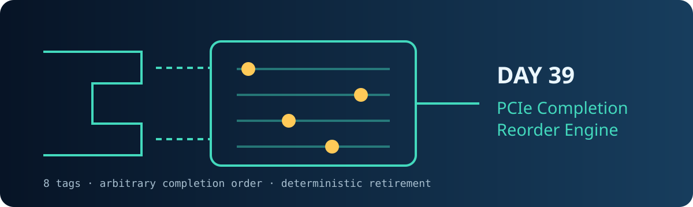
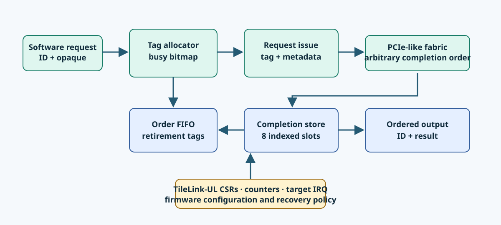

<!-- Author: Asresh -->
# Day 39: PCIe Completion Reorder Engine



A software-programmable split-transaction ordering block for PCIe-style endpoints. Up to eight requests may be outstanding. Hardware assigns compact tags, accepts completions in arbitrary order, and retires `{id, opaque, status, data}` strictly in request order. Invalid or duplicate completions are consumed, counted, and prevented from corrupting live state.

## Why this project

Recent high-compensation systems roles explicitly connect C/C++, RTL simulation, PCIe, AXI, memory ordering, virtualization, and firmware-visible interfaces:

- Apple, **SoC Design Verification Engineer**, posted October 15, 2026: constrained-random RTL verification, PCIe, bus fabric/NoC, AHB/AXI, DMA, C/C++, and HW/FW interaction; listed base pay **$129,300-$225,300**.
- Apple, **Systems Engineer, Platform Architecture**, posted September 22, 2026: hardware/software prototype interfaces, C++ concurrency, SystemVerilog, AXI, atomics, memory ordering, shared memory, and PCIe; listed base pay **$184,700-$324,800**.
- NVIDIA, **Senior System Firmware Engineer**, crawled in October 2026 as posted 11 days earlier: low-level BIOS/OS interfaces including PCIe, JTAG, SPI and I2C; listed Level 5 base pay up to **$356,500**.

This project turns their ordering and hardware/firmware-interface requirements into a small, inspectable RTL block with a C control layer and differential verification.

Sources: [Apple SoC Design Verification role](https://jobs.apple.com/en-us/details/200689562-3956/soc-design-verification-engineer), [Apple Platform Architecture role](https://jobs.apple.com/en-us/details/200684920-0836/systems-engineer-platform-architecture), [NVIDIA System Firmware role](https://nvidia.wd5.myworkdayjobs.com/en-US/NVIDIAExternalCareerSite/job/Senior-System-Firmware-Engineer_JR2025150).

## Hardware/software partition

| Responsibility | Owner | Reason |
|---|---|---|
| Tag allocation, outstanding tracking | RTL | Must make a decision on every accepted request without a firmware round trip. |
| Out-of-order completion capture | RTL | Completion timing is link-driven and can change every cycle. |
| In-order retirement | RTL | Preserves the software contract even when the fabric reorders responses. |
| Batch size, enable, reset, interrupt policy | Software | Workload and recovery policy remain under driver control. |
| Reference completion generation and checksum | Software | Provides an independent correctness oracle and integration test. |
| Invalid/duplicate completion response | Split | Hardware contains and counts the fault; software reads telemetry and chooses recovery. |

## Microarchitecture



1. `pcie_tag_allocator` keeps an eight-bit busy map and chooses the lowest free tag in parallel.
2. `pcie_order_fifo` records tags in request order. Its head is the only tag eligible to retire.
3. `pcie_completion_store` is indexed by tag and stores request metadata separately from completion status/data.
4. The top level validates completion ownership, counts out-of-order arrivals and protocol errors, exposes ordered output, and implements TileLink-UL-style CSRs.

The request-to-issue path is combinational and ready/valid. The completion path never waits on the retirement head. Output backpressure holds the head entry stable. A tag returns to the free pool only after its result is accepted downstream.

## Interfaces

- PCIe-like request issue channel: `req_*` enters with a 16-bit software ID and 32-bit opaque value; `issue_*` adds the allocated tag.
- PCIe-like completion channel: `cpl_*` returns tag, two-bit status, and 32-bit data in arbitrary order.
- Ordered result channel: `out_*` retires original ID/opaque plus completion status/data.
- TileLink-UL-style register channel: one A request and one D response, selected by `tl_a_*` and `tl_d_*`.
- Sticky completion interrupt: asserted when the programmed retirement target is reached and cleared write-one-to-clear.

### Register map

| Offset | Name | Description |
|---:|---|---|
| `0x00` | `CTRL` | bit 0 enable, bit 1 clear state/counters, bit 2 clear IRQ |
| `0x04` | `STATUS` | queue occupancy and IRQ |
| `0x08` | `TARGET` | retired-result target for completion IRQ |
| `0x0c` | `ISSUED` | accepted request count |
| `0x10` | `COMPLETED` | valid completion count |
| `0x14` | `RETIRED` | ordered result count |
| `0x18` | `OOO` | completions arriving behind the current head |
| `0x1c` | `ERRORS` | unallocated-tag or duplicate completions |
| `0x20` | `HIGH_WATER` | maximum outstanding queue occupancy |

Unmapped reads return a D-channel error.

## Verification

The self-checking Icarus test issues **320 requests**: eight directed payload corners and 312 deterministic random payloads. Request issue, completion selection, and ordered-output acceptance use independent randomized stalls. The completion driver deliberately fills all eight tags and then chooses live tags in pseudo-random order. It also injects two invalid completions before traffic starts.

Every retired ID, opaque value, status, and data word is checked against an independent testbench function. The test additionally checks all counters, full-window occupancy, unmapped-register error handling, target interrupt, and W1C acknowledgement.

## Measured results

Host: the repository's macOS Icarus Verilog and C toolchain.

| Metric | Result |
|---|---:|
| Requests / completions / ordered results | 320 / 320 / 320 |
| Directed / randomized vectors | 8 / 312 |
| End-to-end randomized-stall clocks | 760 |
| Ordered requests per clock | 0.421053 |
| Mean clocks per ordered request | 2.375000 |
| Out-of-order completions observed | 143 |
| Deliberate protocol errors contained | 2 |
| Maximum outstanding requests | 8 |
| Checks / mismatches | 1,289 / 0 |
| C reference checksum | `0xe3aa05c61e46be77` |

Yosys was not available. `make synth` therefore ran synthesis-oriented Icarus elaboration of the parameterized RTL successfully. No area, Fmax, power, or timing result is claimed.

## Run

```sh
make sw
make sim
make synth
make check
```

`make check` builds the driver/reference with warnings as errors, then reruns it under AddressSanitizer and UndefinedBehaviorSanitizer.
